# Recomendador de proveedores · COSCO SHIPPING (Sabana Hack 2026)

Sistema de apoyo a la decisión para el **transporte terrestre en Colombia** (reto «El reto de arroz con leche»). Para cada solicitud recomienda un **Top-3 de proveedores**, explicado en pesos, y **una persona toma la decisión final**. Los datos son **sintéticos** (COSCO no los entregó); la «verdad oculta» del simulador solo se usa para evaluar.

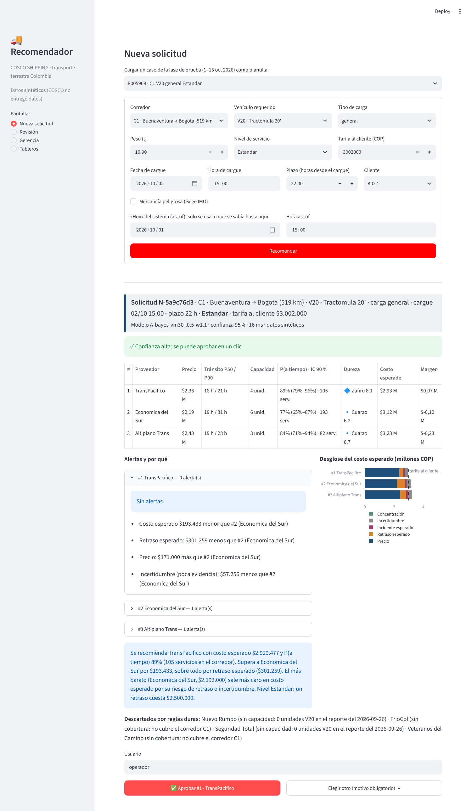

## Qué resuelve

| El reto pide | Dónde está |
|---|---|
| Recomendar el proveedor más adecuado (o una lista corta) para cada solicitud | `POST /recomendar` · pantalla **Recomendar** |
| Combinar precio, tiempo, vehículo, capacidad, desempeño, puntualidad y fortalezas | Costo total esperado en pesos ([cómo decide](#cómo-decide)) |
| Poder explicar por qué uno quedó sobre otro | Tabla comparativa lado a lado, frase del «por qué» y desglose del costo |
| Casos sin opción ideal (sin capacidad, sin vehículo, proveedor nuevo, carga peligrosa) | Reglas duras con motivo, alertas y [`docs/CASOS_DIFICILES.md`](docs/CASOS_DIFICILES.md) |
| Fortalezas, debilidades y riesgos por proveedor | Ficha de proveedor e Índice de Dureza |
| Tableros de precios, tránsito, capacidad, vehículos y tendencias | Pantalla **Panel** y [tableros](#tableros) |
| Demostración y validación con datos históricos y de prueba | [Guion](docs/guion_demo.md), `scripts/replay.py`, `scripts/backtest.py`, banco de comparación |
| Valor de negocio y plan de implementación | [`docs/VALOR_DE_NEGOCIO.md`](docs/VALOR_DE_NEGOCIO.md) |

## Cómo funciona

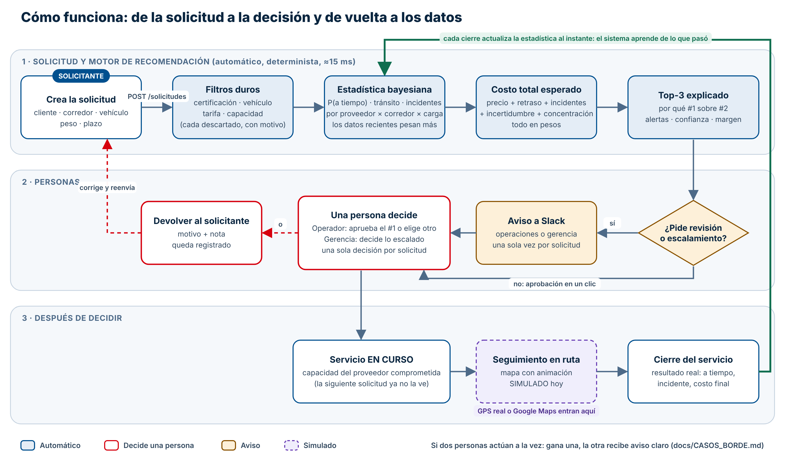

1. **El solicitante crea la solicitud** (cliente, corredor, vehículo, peso, plazo). El servidor le asigna un id y valida peso y fechas; un doble clic crea una sola solicitud.
2. **El motor recomienda** en unos 15 ms: filtros duros → estadística bayesiana → costo total esperado → Top-3 explicado. Es determinista: misma entrada, misma salida.
3. **Si pide revisión o escalamiento**, se avisa una sola vez a Slack. El **operador** aprueba el #1 con un clic o elige otro (con motivo); lo **escalado a gerencia** (por ejemplo, margen negativo) solo lo decide gerencia. Cualquiera de los dos puede **devolver al solicitante** con motivo y nota; el solicitante corrige y reenvía.
4. **Al decidir** nace un servicio EN CURSO (la capacidad del proveedor queda comprometida y la siguiente solicitud ya no la ve), se puede seguir en el mapa (simulado hoy) y, al **cerrarse**, el resultado real actualiza la estadística al instante.

El diagrama se genera con [`docs/arquitectura/funcionamiento_gen.py`](docs/arquitectura/funcionamiento_gen.py) (edita el texto y vuelve a correrlo desde esa carpeta). La arquitectura de módulos está en [Arquitectura](#arquitectura).

## Arranque rápido

**Con Docker (Docker Desktop o Engine):**
```bash
git clone <url-del-repo> && cd cosco-hackaton
docker compose up -d --build
```
- **Frontend Angular:** <http://localhost:4200>
- **API (documentación interactiva):** <http://localhost:8000/docs>
- **Interfaz Streamlit alterna:** <http://localhost:8501>

La primera vez genera los datos sintéticos (~1 min). Para actualizar después de un `git pull`: `docker compose up -d --build`.

**Usuarios de demostración** (misma contraseña `Cosco-2026!`; son **solo de demostración**, cámbialos fuera de la demo):

| Rol | Usuario | Qué puede hacer |
|---|---|---|
| **Solicitante** (comercial) | `comercial` | Crea solicitudes, ve la recomendación y el estado de **sus** solicitudes y su seguimiento. No decide. |
| **Operador** (operaciones) | `operador` | Todo lo anterior sobre todas las solicitudes, más revisar pendientes, decidir, devolver y cerrar servicios; ve proveedores, panel y avisos. |
| **Gerencia** | `jurado` | Todo, además de decidir lo **escalado a gerencia** y activar o desactivar los avisos. |

Los permisos los hace cumplir la API (HTTP 403), no solo el menú.

**Sin Docker (Python 3.10+ y Node ≥ 22.12):**
```bash
python -m venv .venv && source .venv/bin/activate   # Windows: .venv\Scripts\Activate.ps1
make instalar datos test      # o: pip install -r requirements-dev.txt && python scripts/init_datos.py && pytest
make api                      # terminal 1  → http://localhost:8000/docs
make web-instalar && make web # terminal 2  → http://localhost:4200
make ui                       # opcional: Streamlit en :8501
```
En Windows sin `make`: `scripts\setup.ps1` y luego `uvicorn app.api:app`.

## Cómo decide

`filtros duros → estadística bayesiana con decaimiento → costo total esperado → explicación → decide una persona`

- **Filtros duros** (nunca se compensan con un buen puntaje): certificación (IMO en carga peligrosa), vehículo, tarifa vigente y capacidad. Cada descartado lleva su motivo.
- **Bayes**: Beta(17, 3) de partida por proveedor × corredor × tipo de carga; los datos recientes pesan más (vida media de 30 días), así que un proveedor que empeora o mejora se nota.
- **Costo esperado** = precio + P(tarde) · costo del retraso (según nivel de servicio) + P(incidente) · costo + λ · ancho del IC90 · costo + penalización por concentración. **Margen** = tarifa al cliente − costo esperado.
- **Nivel de servicio**: el mismo envío puede tener otro ganador en Flexible, Estándar o Urgente, porque llegar tarde cuesta distinto ($300 mil · $2,5 M · $6 M).
- **Pasa por una persona** siempre en Urgente y cuando la confianza es baja. **Se escala a gerencia** cuando el margen esperado es negativo, ningún proveedor llega dentro del plazo con margen, o no hay proveedores factibles. Un **empate técnico** (diferencia < 3 % entre los dos primeros) se informa, pero no obliga a revisar.
- **Proveedor nuevo**: nunca entra al ranking por azar. Aparte, y solo en Flexible, se sugiere una prueba con su costo en pesos; decide la persona.
- **Motores intercambiables** mediante el contrato `MotorDecision`: A (propio) y B (Jev) están **medidos**; C (LLM) se descartó y figura como «no medido».

**Parámetros** (todos en [`engine/config_motor.json`](engine/config_motor.json), no en el código; las cifras son ilustrativas y deben calibrarse con COSCO):

| Parámetro | Valor | Efecto |
|---|---|---|
| `costo_retraso` | $300 mil · $2,5 M · $6 M | Cuánto cuesta llegar tarde (Flexible · Estándar · Urgente) |
| `costo_incidente` | $8 M | Cuánto cuesta un incidente |
| `vida_media_dias` | 30 | Qué tan rápido «olvida» el sistema datos viejos |
| `lambda_incertidumbre` | 0,5 | Penalización a proveedores con pocos datos |
| `prior_alfa` / `prior_beta` | 17 / 3 | Qué se asume de un proveedor sin historial (~85 % a tiempo) |
| `concentracion_umbral` | 35 % | Desde qué cuota de servicios se penaliza concentrar en un proveedor |
| `empate_tecnico_pct` | 3 % | Diferencia bajo la cual se informa un empate técnico |
| `pocos_datos_n` | 10 | Servicios mínimos en el corredor antes de alertar «poco historial» |
| `dureza_pesos` | 50/20/15/15 | Pesos del Índice de Dureza (puntualidad, variabilidad, incidentes, rechazo) |

`vida_media_dias` y `lambda_incertidumbre` se eligieron con un backtest de 1.586 solicitudes ([`reportes/paso11_backtest.md`](reportes/paso11_backtest.md)); los costos de retraso e incidente son supuestos del equipo.

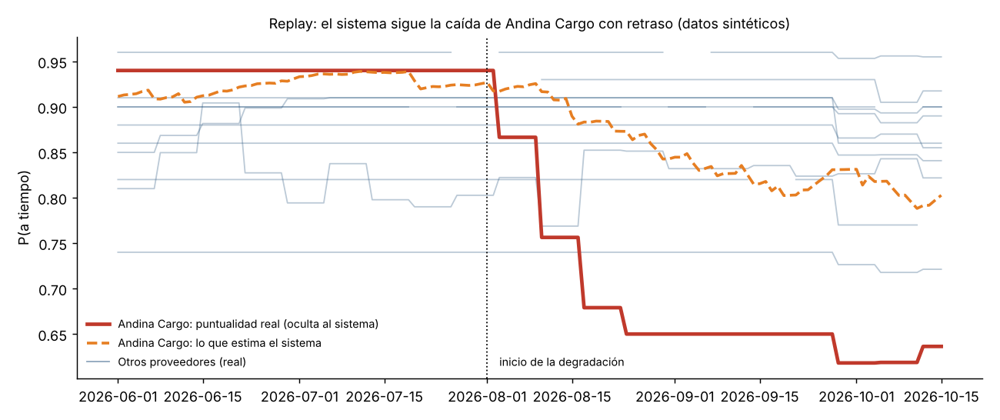

**Evidencia** (banco de comparación sobre 500 solicitudes, [`reportes/paso13_banco.md`](reportes/paso13_banco.md)):

| Motor | Arrepentimiento medio por servicio | Elige el óptimo |
|---|---|---|
| A · propio (bayesiano + costo esperado) | $95.664 | 66,1 % |
| B · Jev | $159.419 | 50,7 % |
| Siempre el más barato | $205.423 | 49,9 % |
| Aleatorio | $386.392 | 27,2 % |

En el replay, el sistema detecta la caída de Andina Cargo unos 12 días después de que empieza. La comparación usa datos sintéticos; el LLM no se midió.

## Pantallas (Angular, español · inglés · chino)

| Pantalla | Quién | Para qué |
|---|---|---|
| **Nueva solicitud** | todos | Formulario con validación de peso y plazo; botón de ejemplo |
| **Recomendar** | todos (decide operador/gerencia) | Comparación lado a lado, «por qué #1 sobre #2», descartados con motivo, aprobar/elegir/devolver |
| **Solicitudes** | todos (el solicitante solo ve las suyas) | Estado: lista, en revisión, escalada, decidida, devuelta |
| **Seguimiento** | todos | Mapa animado de cada servicio en ruta ([simulado](docs/SEGUIMIENTO.md)) |
| **Pendientes** | operador, gerencia | Cola de casos por revisar o escalados |
| **Proveedores** | operador, gerencia | Ficha, fortalezas, debilidades, riesgos e Índice de Dureza |
| **Panel** | operador, gerencia | Precios, tránsito, capacidad, vehículos y tendencias |
| **Avisos** | operador, gerencia | Historial de avisos; gerencia activa/desactiva y envía una prueba |

Inicio de sesión con JWT, contraseñas con PBKDF2 y bloqueo tras 5 intentos fallidos. Colores de COSCO SHIPPING. Detalle en [`web/README.md`](web/README.md).

## Tableros

| | |
|---|---|
| 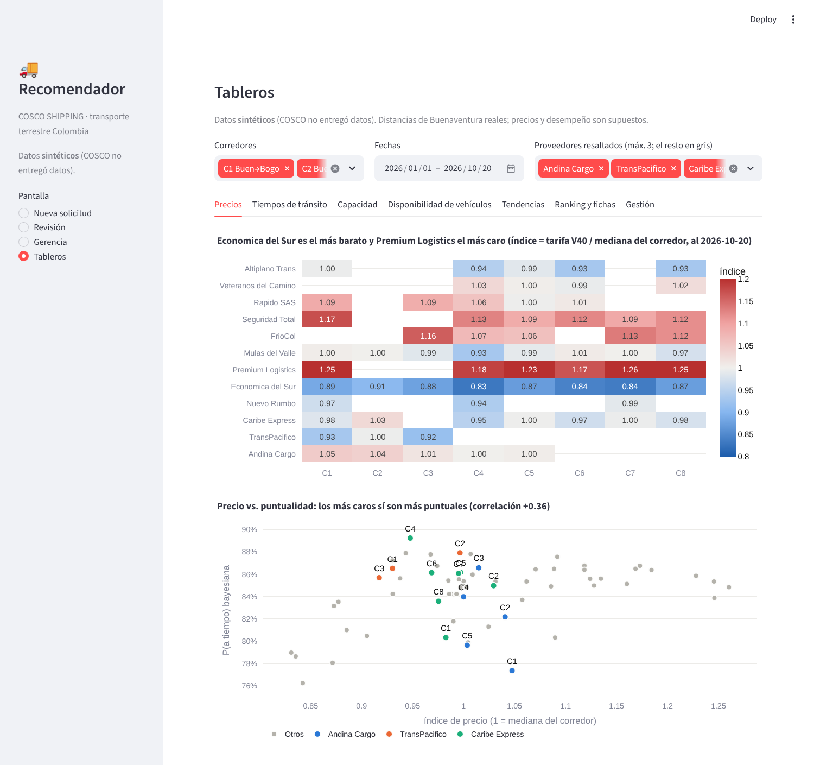 | 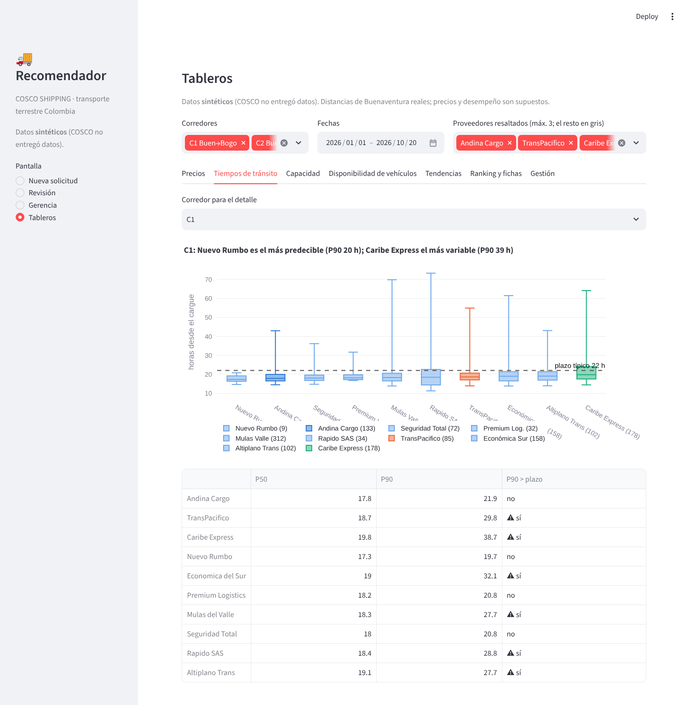 |
| 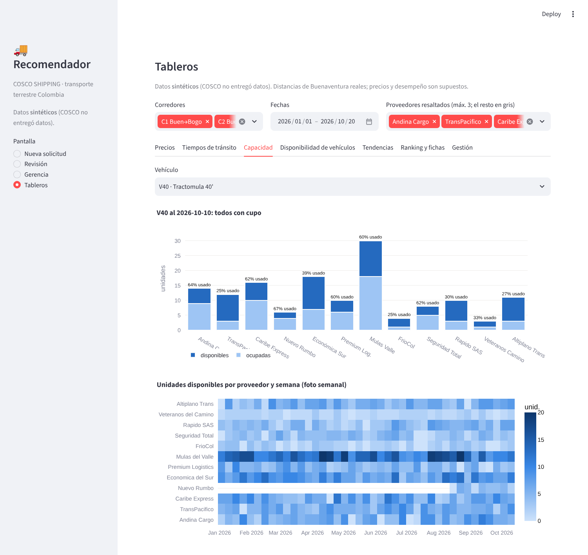 | 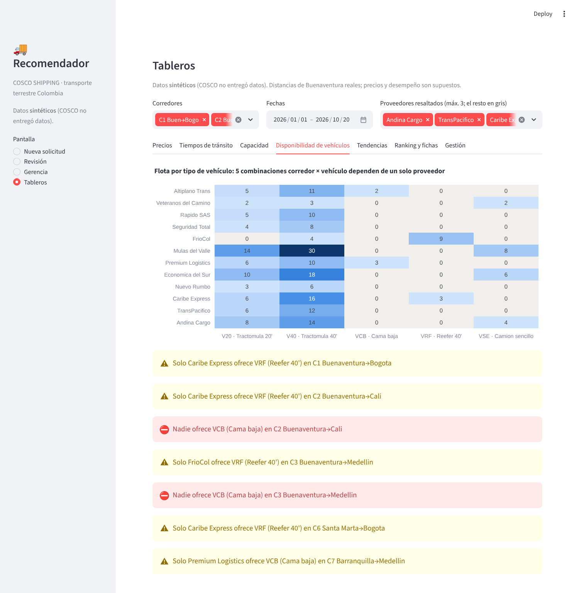 |
| 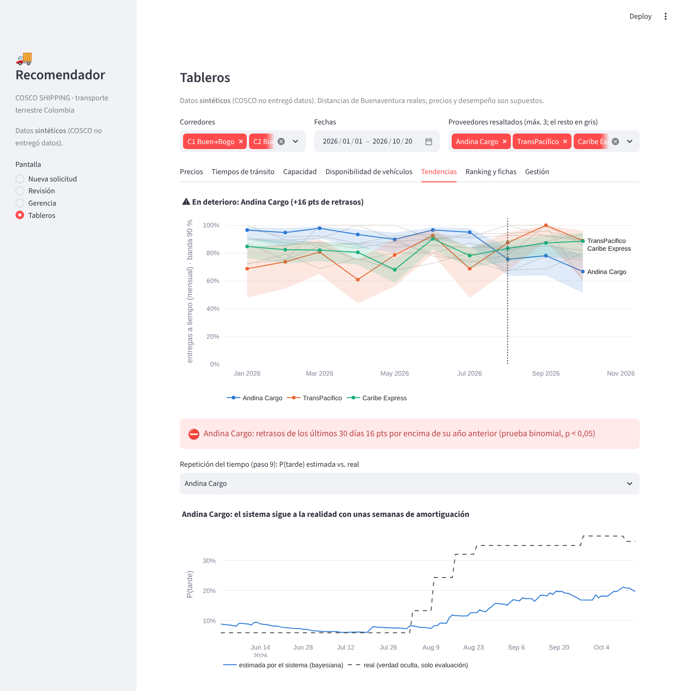 | 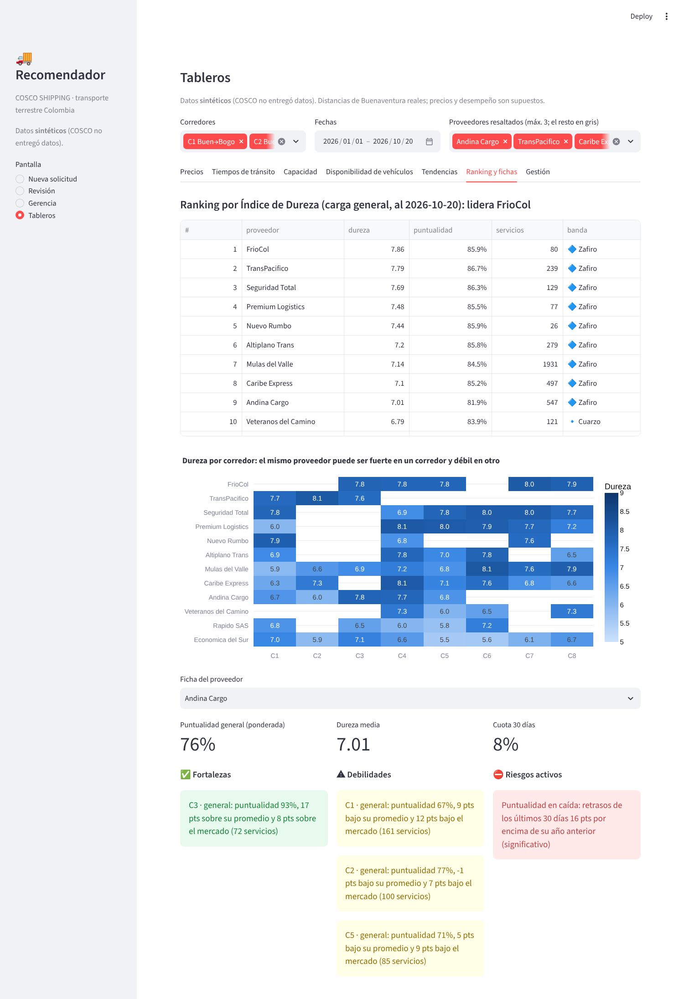 |
| 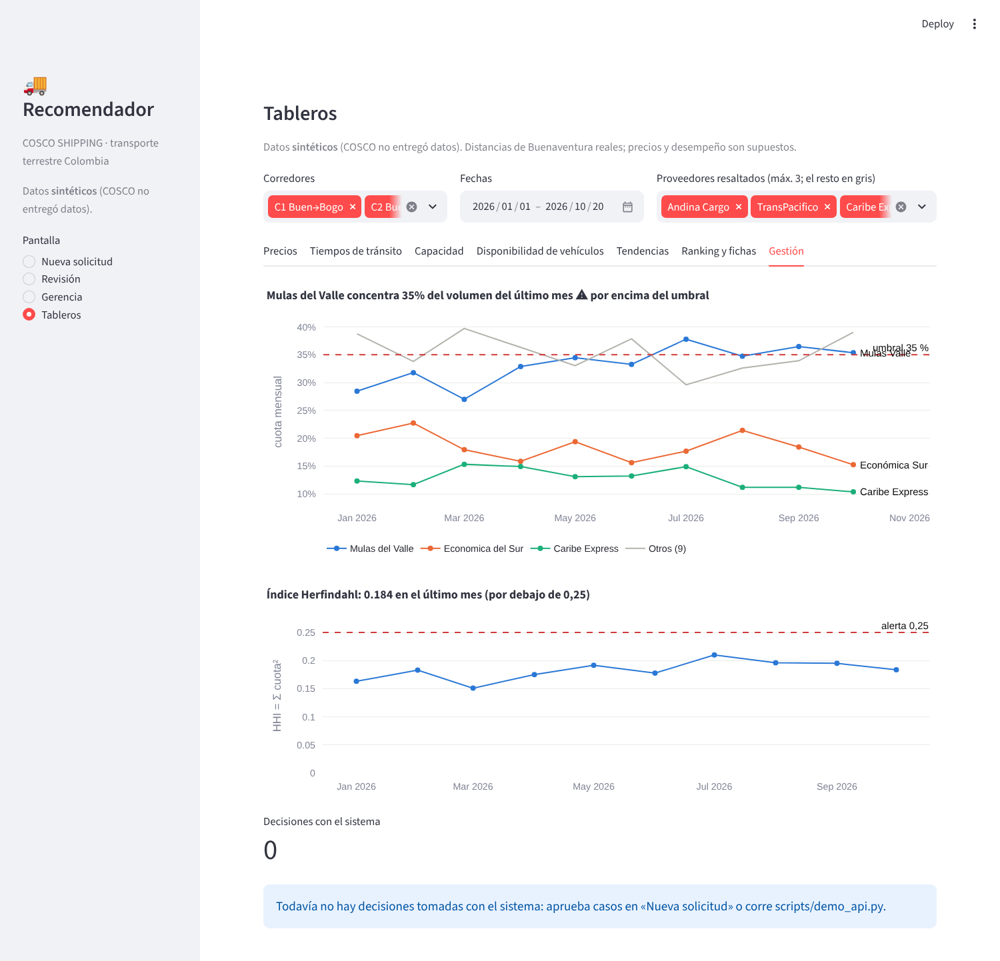 | 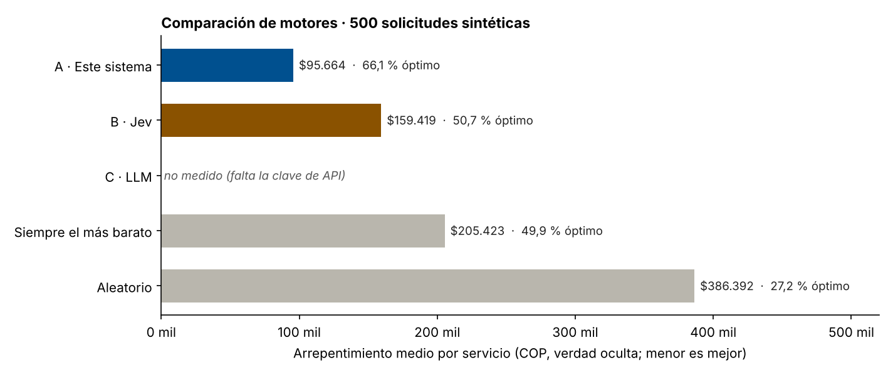 |

## Arquitectura

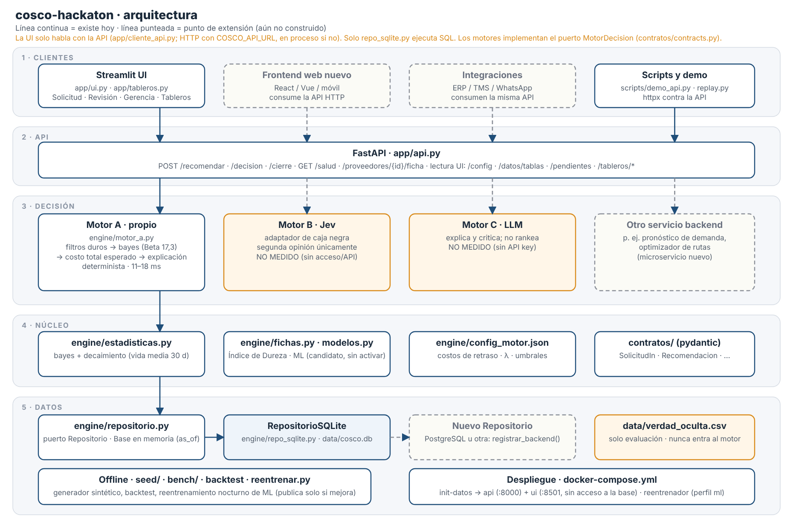

Detalle, decisiones y puntos de extensión en [`docs/ARQUITECTURA.md`](docs/ARQUITECTURA.md). Versión web: [`docs/arquitectura/index.html`](docs/arquitectura/index.html).

## Avisos por Slack

Cuando una recomendación necesita a una persona, se avisa **una sola vez por solicitud**: «revisión necesaria» al canal de operaciones y «escalamiento» al de gerencia, con corredor, motivos, la primera opción del modelo y un enlace al caso. Si Slack falla, la recomendación sigue su curso y el caso queda en «Pendientes»; el fallo se ve en **Avisos**.

1. En Slack crea un *Incoming Webhook* ([guía](https://api.slack.com/messaging/webhooks)) para cada canal.
2. Pon las URLs en tu `.env` (no se versiona): `COSCO_SLACK_WEBHOOK` para un solo canal, o `COSCO_SLACK_WEBHOOK_OPERACIONES` y `COSCO_SLACK_WEBHOOK_GERENCIA` para canales separados. Solo se aceptan URLs `https://hooks.slack.com/…` y la API nunca las devuelve.
3. Reinicia con `docker compose up -d`.

## Solicitudes simultáneas y casos borde

- **Nueva solicitud** (`POST /solicitudes`): idempotente por `clave_envio`; un doble clic o dos pestañas crean **una** solicitud y **un** aviso.
- **Una sola decisión por solicitud**: si dos personas deciden a la vez, gana una y la otra recibe «ya fue decidida por …» (409). Decidir y devolver al mismo tiempo: queda solo una de las dos.
- **Capacidad**: los servicios en curso descuentan unidades; dos solicitudes por la última unidad no la toman las dos.
- **Devolver al solicitante** (`POST /rechazo`; lo escalado, solo gerencia): motivo obligatorio y nota; el solicitante ve «Devuelta» y puede crear una nueva con los mismos datos.

Tabla completa y límites en [`docs/CASOS_BORDE.md`](docs/CASOS_BORDE.md). Demo en vivo: `python scripts/demo_concurrencia.py`.

## Seguimiento en ruta (simulado)

La pantalla **Seguimiento** anima cada servicio sobre su corredor (reproducir, pausa, 1×/2×/4×) y dice si «llegaría a tiempo». **No hay GPS conectado**: el recorrido se simula con el tránsito de cada proveedor. Está preparada para cambiar la fuente de ubicación (GPS, telemetría del proveedor) o el mapa (Google Maps) sin tocar la pantalla; ver [`docs/SEGUIMIENTO.md`](docs/SEGUIMIENTO.md).

## API

Toda la API (salvo `/salud` y `/auth/login`) exige sesión. Documentación interactiva en `/docs`.

| Método y ruta | Rol | Uso |
|---|---|---|
| `POST /auth/login` | — | Inicia sesión (JWT) |
| `GET /salud` | — | Estado del servicio y de los datos |
| `POST /recomendar` | todos | Solicitud → Top-3, descartados, alertas, explicación |
| `POST /solicitudes` | todos | Crea una solicitud nueva y devuelve su recomendación |
| `GET /mis-solicitudes` | todos | Estado de las solicitudes (el solicitante, solo las suyas) |
| `GET /seguimiento` | todos | Servicios en ruta con su recorrido (simulado) |
| `POST /decision` | operador, gerencia | Registra qué decidió la persona (y por qué si se aparta del #1) |
| `POST /rechazo` · `GET /rechazos/{sid}` | operador, gerencia | Devuelve al solicitante / consulta la devolución |
| `POST /cierre` | operador, gerencia | Registra el resultado real del servicio |
| `GET /pendientes` · `GET /tableros/*` | operador, gerencia | Cola de revisión o de gerencia; datos de los tableros de gestión |
| `GET /proveedores/{id}/ficha` | todos | Ficha e Índice de Dureza |
| `GET /datos/tablas` · `/config` · `/solicitudes/*` | todos | Datos de referencia para las interfaces |
| `GET`/`PUT /notificaciones/ajustes` · `GET /notificaciones/historial` · `POST /notificaciones/probar` | operador, gerencia (cambiar y probar: gerencia) | Avisos de Slack |

## Configuración

Copia `.env.example` a `.env` para cambiar valores. Las claves y webhooks van **solo** ahí (no se versiona).

| Variable | Para qué |
|---|---|
| `API_PORT`, `WEB_PORT`, `UI_PORT` | Puertos (8000, 4200, 8501) |
| `COSCO_SEED` | Semilla de los datos sintéticos (el reto usa 7) |
| `COSCO_REPO` / `COSCO_DB` | Base de datos (SQLite por defecto; otra con un backend registrado) |
| `COSCO_JWT_SECRET` | Secreto de sesiones (≥ 32 caracteres) |
| `COSCO_SEED_USER`, `COSCO_SEED_PASSWORD` | Usuario semilla (demostración) |
| `COSCO_SLACK_WEBHOOK`, `COSCO_SLACK_WEBHOOK_OPERACIONES`, `COSCO_SLACK_WEBHOOK_GERENCIA`, `COSCO_PUBLIC_URL` | Avisos de Slack y enlace al caso |
| `COSCO_UBICACION` | Fuente de ubicación del seguimiento (`simulador`) |
| `TYPESAFE_API_KEY`, `JEV_MODEL` | Solo para comparar con Jev (`bench/comparar.py`) |

## Estructura

```
app/        API (FastAPI, con autenticación) · interfaz y tableros (Streamlit)
web/        frontend Angular (es · en · zh) y pruebas de navegador (web/e2e)
engine/     estadística, fichas, modelos, motor A, ubicación, configuración
contratos/  contratos pydantic (fuente de verdad, con db/schema.sql)
seed/       generador sintético, 35 reglas de calidad, simulador en vivo
scripts/    replay, backtest, demo, demo de concurrencia, init_datos (Docker)
bench/      banco de comparación de motores
tests/      pytest
docs/       arquitectura, diagrama de funcionamiento, guion, casos borde, referencias
```

## Extender sin reescribir

- **Los frontends solo hablan con la API**: Angular por HTTP con sesión, Streamlit vía `app/cliente_api.py`. Otro frontend puede hacer lo mismo.
- **La base de datos está detrás de un puerto** (`engine/repositorio.py`): para PostgreSQL u otra se escribe una clase, se registra con `registrar_backend` y se apunta `COSCO_REPO`; `tests/test_repositorio.py` define el contrato.
- **La fuente de ubicación está detrás de un puerto** (`engine/ubicacion.py`) y **el mapa detrás de otro** (`web/src/app/core/mapa`): GPS real o Google Maps se enchufan sin cambiar la pantalla.
- **Reentrenamiento nocturno** de M1/M2 (`docker compose --profile ml up -d` o `make reentrenar`): publica un candidato solo si supera a la estadística bayesiana y lo deja pendiente de aprobación humana.
- **Datos reales:** llena `docs/referencia/plantilla_datos.xlsx`, cárgala con `python -m scripts.importar_datos datos.xlsx --out data/real.db` y usa `COSCO_DB=data/real.db`.

## Reglas del proyecto

1. Contratos y esquema son la fuente de verdad.
2. `data/verdad_oculta.csv` nunca entra al motor ni al entrenamiento.
3. Todo cálculo recibe `as_of` y no ve el futuro.
4. Si algo no se midió, se escribe «no medido».
5. Las claves y webhooks no se escriben en el repositorio ni en el chat.

## Pruebas y calidad

| Qué | Cómo | Resultado actual |
|---|---|---|
| Backend (incluye concurrencia, roles, seguimiento y guion de demo) | `make test` | 97 pruebas |
| Estilo | `make lint` (ruff) y CI en `.github/workflows/ci.yml` | sin errores |
| Frontend (unitarias) | `cd web && npx vitest run` | 8 pruebas |
| Navegador de punta a punta | `node web/e2e/flujo_roles.cjs` y `node web/e2e/flujo_nueva.cjs` (con la pila arriba y una base limpia) | recorridos por rol, solicitud nueva y devolución |

## Límites conocidos (dichos con honestidad)

- Los datos son sintéticos; precios y desempeño son supuestos del equipo, salvo las distancias de Buenaventura.
- El motor es menos puntual que el analista humano en algunos casos; por eso la persona decide.
- El seguimiento y sus rutas son una simulación aproximada, sin GPS real.
- La reserva de capacidad solo cuenta decisiones posteriores a la última foto de capacidad.
- SQLite escribe de a uno; basta para el reto y se cambia por otra base sin tocar el motor.
- Las traducciones al chino necesitan revisión de un hablante nativo.

## Más documentación

[`docs/ARQUITECTURA.md`](docs/ARQUITECTURA.md) · [`docs/guion_demo.md`](docs/guion_demo.md) · [`docs/CASOS_BORDE.md`](docs/CASOS_BORDE.md) · [`docs/SEGUIMIENTO.md`](docs/SEGUIMIENTO.md) · [`docs/VALOR_DE_NEGOCIO.md`](docs/VALOR_DE_NEGOCIO.md) · [`docs/CASOS_DIFICILES.md`](docs/CASOS_DIFICILES.md) · [`docs/REVISION_PROYECTO.md`](docs/REVISION_PROYECTO.md) · [`CLAUDE.md`](CLAUDE.md) · [`PASOS_Y_PROMPTS.md`](PASOS_Y_PROMPTS.md)
