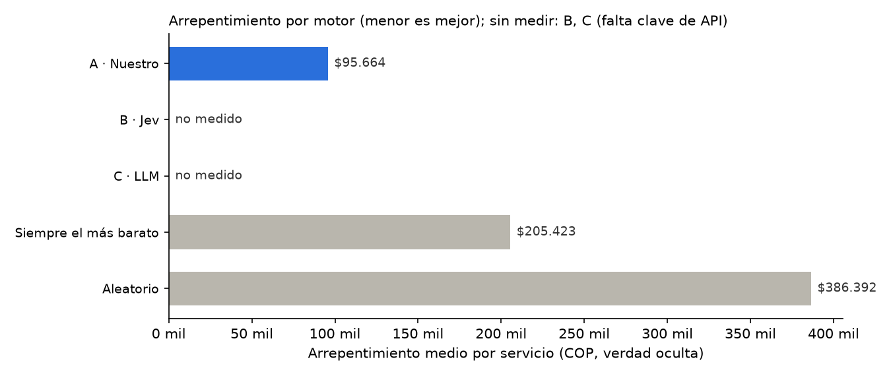

# Paso 13 · Banco de comparación: Motor A frente a Jev y un LLM

500 solicitudes (264 de la fase de prueba, 1–15 oct 2026, y el resto muestreadas con semilla fija de jul–sep 2026). Datos **sintéticos**.
Arrepentimiento = costo real esperado del Top-1 − costo del mejor proveedor factible, con la verdad oculta del simulador (solo evaluación).
Todos los motores ven los mismos proveedores factibles: las reglas duras las aplica nuestro código.

| Motor | Arrepentimiento medio | Elige el óptimo | Acuerdo con A (Top-1) | % a revisión | Latencia p50 / p95 | Costo |
|---|---|---|---|---|---|---|
| A · Nuestro (bayesiano + costo esperado) | $95.664 | 66.1 % | 100.0 % | 51.5 % | 11.4 / 17.2 ms | ≈ 0 (cómputo propio) |
| B · Jev (jev-1.13.0) | no medido | no medido | no medido | no medido | no medido | no medido (falta TYPESAFE_API_KEY) |
| C · LLM (claude-haiku-5-5, solo explica) | no medido | no medido | no medido | no medido | no medido | no medido (falta ANTHROPIC_API_KEY) |
| Siempre el más barato | $205.423 | 49.9 % | 70.8 % | — | — | — |
| Aleatorio | $386.392 | 27.2 % | 29.0 % | — | — | — |

### Motor A por nivel de servicio

| Nivel | n | Arrepentimiento medio | Elige el óptimo | % a revisión |
|---|---|---|---|---|
| Estandar | 254 | $72.279 | 60.6 % | 50.0 % |
| Flexible | 134 | $1.649 | 94.8 % | 17.9 % |
| Urgente | 101 | $279.208 | 41.6 % | 100.0 % |

## Robustez

| Prueba | A · Nuestro | B · Jev |
|---|---|---|
| Orden de proveedores cambiado | 100 % igual | no medido |
| Nombres de proveedores cambiados | 100 % igual | no medido |
| 5 proveedores irrelevantes añadidos | 100 % igual | no medido |
| Misma solicitud ×20 (JSON idéntico) | 100 % igual | no medido |

## Lectura

- Las filas de B y C dicen «no medido» cuando no hay clave de API en el entorno: **no se afirma ninguna ventaja ni desventaja de Jev o del LLM hasta medirlos** con esta misma batería.
- Para medirlos: `export TYPESAFE_API_KEY=...` (y opcionalmente `JEV_MODEL=jev-1.13.0`), `export ANTHROPIC_API_KEY=...` y `LLM_MODEL=...`; luego `python bench/comparar.py`.
- El motor A es determinista: el Top-3 no depende del orden ni de los nombres de los proveedores, y los proveedores irrelevantes salen como descartados con motivo.
- Los datos simulados siguen una estructura parecida a la que supone el motor A, así que su ventaja frente a las referencias probablemente está exagerada respecto a datos reales.

